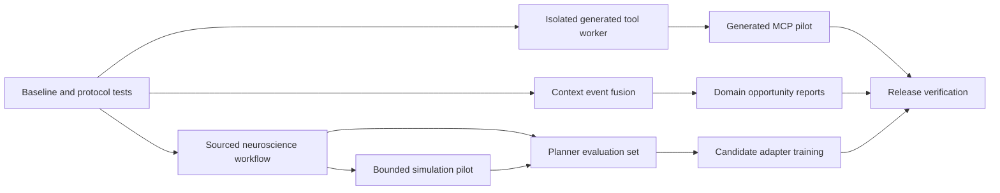

# ORION capability enhancement roadmap

**28 September 2026 · Architecture validation and delivery plan**

## Decision

Advance ORION through small, measured extensions to its existing perception, MCP, Forge, mission, finance and planner systems. The first release should prove one useful neuroscience research workflow and a safe MCP compatibility path. Continuous context, generated MCP servers and model training follow only when their specific gates pass. A new capability is complete when it works through the normal dispatcher, survives failure and restart, has an observable result, and can be disabled or rolled back.

This roadmap is based on the current, heavily modified checkout. Source inspection establishes that code paths exist; it does **not** establish that a configured external server is connected, that a camera or microphone has been exercised on the target PC, or that a proposed model improves ORION. Earlier roadmaps are useful history but are not release evidence. The user prompt's references to long-term memory and “10 TB RAM” are goals, not verified capacity.

## Implementation started — 28 September 2026

The first development slice is now in the checkout. [`mcp_host.py`](../orion_core/mcp_host.py) probes 2026 `server/discover`, retains a validated legacy handshake fallback, checks malformed replies and versions, and refreshes tool routes and health after a reconnect or disablement. [`test_mcp_interoperability.py`](../tests/test_mcp_interoperability.py) exercises both wire-era fixtures, failed processes, changed schemas, cancellation and approval for a write tool. The actual current Python SDK server could not be run in this environment; the optional SDK test remains a release gate.

The existing `research` tool now has a bounded [`neuroscience_pilot`](../orion_core/neuroscience_research.py) action. Its [provisional mission brief](NEUROSCIENCE_STDP_PILOT_2026-09-28.md) ties three narrow claims to two reviewed PubMed abstracts and records what was not tested. It reads the existing Neuroscience Research mission without changing it. [`context_events.py`](../orion_core/context_events.py) defines a versioned, in-memory event envelope and bounded broker with synthetic audio, visual and system tests. No sensor is connected to that broker yet.

[`app.py`](../orion_core/app.py) now attaches the existing neural planner only when its flag or saved preference enables it. The initial mode remains shadow/read-only, and resource-pressure and shutdown hooks release optional work. [`PlanReport.to_tool_result`](../orion_core/plan_executor.py) now passes structured step receipts to the consent-gated feedback path; a screen change is explicitly not treated as a verified postcondition. The original-state table below records the architecture as inspected before this implementation slice; remaining phases and acceptance gates still apply.

**Verification on this checkout:** the focused MCP, planner, parallel execution, neural feedback, startup, mission/research, and context suites completed with **402 passed and 4 skipped**. The skipped cases require a current MCP Python SDK, a Windows symlink capability, or a live Ollama instance. A current SDK server, live sensors, live planner quality, and target-PC performance have not been verified. The isolated generated-tool worker, context bus/consent wiring, simulation, and finance/enterprise phases remain future work.

## What exists and what remains

| Prompt area | Verified current state | Actual gap |
| --- | --- | --- |
| Episodic perception | [`PerceptionLoop`](../orion_core/perception.py) already samples a shared camera source locally at 2 fps and emits events; [`SoundWatch`](../orion_core/sound_watch.py) classifies short windows from the existing audio buffer when started. [`resource_monitor.py`](../orion_core/resource_monitor.py) supplies on-demand readings; [`resource_governor.py`](../orion_core/resource_governor.py) runs the continuous pressure loop. Vision starts on request or enabled rule autostart; sound watch is opt-in. The active camera loop can call a cloud describer on events or a heartbeat without a separate cloud-sharing switch. | A single, consent-aware event contract and fusion policy across sensors and resources; measured behaviour under real device and foreground load. A second capture stack would duplicate ownership. |
| MCP constraints | [`MCPHost`](../orion_core/mcp_host.py) launches and supervises stdio servers; the [dispatcher](../orion_core/dispatcher.py) registers their tools, and dispatcher paths enforce configured confirmation rules. The custom client advertises protocol `2024-11-05` at `initialize` without checking the returned version; remote HTTP servers need a bridge. Enabled configuration is not live connectivity. | Compatibility testing with current MCP servers and a deliberate host upgrade path; enforceable risk classification for newly declared tools; stronger isolation of untrusted server code. |
| Dynamic Forge | [`Forge`](../orion_core/forge.py) generates and verifies Python custom tools; [`MCPHost.add_server`](../orion_core/mcp_host.py) can declare a server, with local approval for model-facing changes. Optional container verification exists. | It does not generate MCP servers. Accepted Python tools still run in ORION's process. Plugin permission declarations do not sandbox code at runtime; existing tier and confirmation gates still apply. A process boundary is the gate before broader autonomous generation. |
| Strategic awareness | [`CognitiveLoopManager`](../orion_core/cognitive_loop.py) observes workspace, turns and deadlines; [`ProactiveIntelligence`](../orion_core/proactive.py) surveys existing email, calendar, task and repository sources. | Normalised cross-domain evidence, freshness and user-directed priorities; domain-specific decision support. |
| Neuroscience | The [Neuroscience Research mission](../config/missions.json) exists but its goals, tasks, files and research lists are empty. ORION has a neuroscience agent and [resident corpus](../orion_core/knowledge.py). | A concrete research question, sourced retrieval and reproducible simulation. No simulator integration was found. |
| Finance and enterprise | [`finance.py`](../orion_core/finance.py) is a local manual/CSV ledger with runway reporting. [Notion](../orion_core/notion.py) and [Outlook](../orion_core/outlook.py) bridges exist. | Forecast scenarios and reconciled data first; any bank, treasury, ERP or CRM connector requires a named system, credentials, scopes and separate validation. |
| Neural enhancement | Small [NumPy networks](../orion_core/neural.py) support routing rather than general reasoning. An [optional planner](../orion_core/neural_planner.py), [feedback store](../orion_core/neural_feedback.py), [trainer](../tools/train_planner_adapter.py), [evaluation gate](../tools/evaluate_planner.py) and rollback path exist. | The planner's `install_autoplan_route` appears in its module and tests, with no production call site found in `app.py`. Live model quality, GPU training and benefit are unverified. First prove integration and baseline performance. |

The [26 September hardware snapshot](ORION_ARCHITECTURE_PERFORMANCE_REVIEW_2026-09-26.md) measured 15.92 GiB usable RAM and an 8 GiB RTX 3060 Ti. A fresh `nvidia-smi` query confirmed the GPU and its 8,192 MiB total VRAM; a fresh RAM query was denied. Plan against the measured 16 GiB class machine until a new resource baseline is captured. The “10 TB” entries in a cognitive-state backup do not establish installed memory or a deployable remote system. The existing [neural architecture guide](ORION_NEURAL_ARCHITECTURE_GUIDE.md) also treats training a foundation model from scratch on this desktop as impractical.

## Priority and dependency

| Order | Work package | Value | Delivery size | Why this order |
| --- | --- | --- | --- | --- |
| 1 | Baseline, MCP compatibility and neuroscience mission definition | High | Small | Resolves uncertain protocol and mission requirements before dependencies or data are added. |
| 2 | Sourced neuroscience research slice | High | Medium | Uses existing research, memory and agent paths; proves mission value without needing new model training. |
| 3 | Cross-modal context fusion over current sensors | High | Medium | Extends working loops and gives later domain tools fresh, attributable observations. |
| 4 | Isolated Forge worker and one read-only generated MCP pilot | High strategic value | Large | Tests adaptability with a contained executable and rollback before wider generation. |
| 5 | Finance scenarios, then a selected enterprise connector | Medium until target known | Medium to large | Extends existing data and avoids speculative ERP/CRM work. |
| 6 | Planner integration, live evaluation and candidate training | Conditional | Large | Model work should follow a tested workflow and an observed quality gap. |

The second and third rows above can proceed in parallel after the baseline. The phase numbers below describe technical workstreams, not a strict calendar: Phase 4A's literature pilot can start before Phases 2 and 3 finish. The generated MCP pilot requires protocol compatibility and execution isolation. Each package carries the verification requirements in Phase 6; they are not deferred to the end.

## Phase 1 — establish baseline and validate architecture

**Deliverables**

1. Record a clean capability inventory from the *current* checkout: registered dispatcher tools, configured MCP servers, actual connection health, sensor state, Forge verification profile, neural planner mode, model/provider availability and active resource budgets. Keep secrets and private records out of the report. The existing [capability summary](ORION_CAPABILITIES_2026-09-26.md) is a starting point, not a live health check.
2. Add an MCP interoperability fixture: a legacy stdio server, a current SDK server, a mismatched returned protocol version, invalid JSON/protocol replies, dropped subprocess, changed tool schema, and approval-requiring write tool. Verify discovery, typed errors, reconnection, truthful health and cancellation. ORION's host currently sends `initialize`; the [July 2026 MCP revision](https://blog.modelcontextprotocol.io/posts/2026-07-28/) introduced `server/discover` for its new stateless core, while the [official Python SDK](https://github.com/modelcontextprotocol/python-sdk) supports older revisions. That combination needs an actual compatibility test before a generated server is enabled.
3. Measure on the target Windows PC, with ORION visibly running: idle and mixed-load RAM/VRAM/CPU, first useful voice response, desktop frame and event-loop latency, camera/audio detection delay, MCP server startup/parking, and local planner shadow latency. Repeat under memory pressure. Save the machine, driver, model, test inputs and timestamps with the measurements.
4. Give the Neuroscience Research mission one question, expected output, source set and success criterion. Link it through existing mission records instead of inventing an unrelated project. If no research question is available, use a small literature-review pilot with a clearly labelled provisional question and defer simulator selection.

**Exit gate:** one reproducible baseline report; interoperability results for each server class; no secret in artefacts; one mission brief. The current CI checks ([workflow](../.github/workflows/ci.yml)) and focused tests pass from this checkout. Any hardware or external-service result not exercised is marked unverified.

## Phase 2 — safe dynamic capability creation

**Goal:** produce a new, *read-only* MCP capability from a typed specification, verify it, and register it without allowing generated code to run with ORION's full desktop authority.

**Design:** keep Forge's existing proposal, contract, test and transaction stages. Add an MCP server artefact type with a bounded manifest: tool names, JSON schemas, read/write class, external domains, resource ceilings, dependencies, credential needs and a deterministic test fixture. Generate into a quarantined directory. Validate protocol compatibility, output schema, timeouts, cancellation, tool-name collisions, resource ceilings and forbidden imports before proposing activation. Map the manifest's read/write class to an enforced dispatcher approval gate; an unknown tool, including a write tool with an innocuous name, must not bypass it. Start with local stdio; add remote transport only after host support and authentication tests exist. The official SDK describes [stdio for local subprocesses and Streamable HTTP for deployments](https://github.com/modelcontextprotocol/python-sdk/blob/main/docs/run/index.md).

**Execution boundary:** run generated or third-party server code in a separate, low-privilege worker with an explicit data/credential grant. Deny source checkout, unrelated secrets, network and filesystem by default; grant only the pilot's declared needs. The existing [`forge_isolation.py`](../orion_core/forge_isolation.py) container isolates verification, but the accepted Python plugin is loaded into the live process. Move live generated execution behind a worker before treating its manifest as an enforceable policy. The existing [host policy](../orion_core/mcp_policy.py) constrains known arguments and environments but explicitly does not sandbox a malicious server.

**Pilot:** generate a read-only neuroscience catalogue tool over a small, approved local fixture. It returns topic identifiers, source provenance and schema-valid summaries; it has no general Python evaluation, shell, network, or write tool. A local approval reviews exact code, manifest, dependencies and granted paths before enabling it. If a tool spec changes, re-review the changed digest. ORION may discover gaps and draft candidates automatically; deployment and expansion of grants remain deliberate operations.

**Exit gate:** contract tests and real stdio handshake pass; crafted prompt injection, path traversal, environment leakage, oversized output, hung tool and crash cases are contained; disabling or reverting the server removes its tools and restores prior behaviour. No test success is described as an OS sandbox guarantee.

## Phase 3 — continuous context from existing loops

**Goal:** turn current local perception and operational signals into timely, attributable context for the existing awareness and proactive surfaces.

**Design:** add one versioned event envelope over `OrionBus`, for example `event_id`, `source`, `observed_at`, `expires_at`, `confidence`, `evidence_ref`, `sensitivity`, and a bounded typed payload. The event broker deduplicates, coalesces, expires and orders observations; it does not own a second camera or microphone handle. ORION's current camera source and rolling audio buffer remain the device owners. The broker passes a compact state summary to [`cognitive_loop.py`](../orion_core/cognitive_loop.py) and [`proactive.py`](../orion_core/proactive.py); high-salience events use the existing dashboard/notification route. Resource pressure uses [`resource_governor.py`](../orion_core/resource_governor.py) and [`admission.py`](../orion_core/admission.py) to shed optional sensing.

**Consent and data:** separate visible camera, audio and screen controls; default off where sensing is not already enabled. Show source and last event time. Keep raw media volatile by default, and persist only minimal event summaries under a documented retention setting. Add a distinct cloud-sharing opt-in and budget before broadening the camera loop: today's loop can send frames to its cloud describer after camera watching starts. A revoked permission or missing source produces an explicit degraded state, not a stale “watching” claim. Any external MCP view of context is read-only, minimised and separately authorised; MCP is an exposure boundary, not the internal event bus.

**Exit gate:** replayed audio/visual/system fixtures produce one correctly attributed, fresh event each; stop and shutdown release devices and tasks; revoked permissions and missing models degrade honestly. Proposed target for a real-device trial is p95 event-to-surface delay below 3 seconds for supported local alerts, with no more than 10% regression in foreground voice/UI p95 and bounded incremental RAM/CPU. Phase 1 measurements may revise these provisional budgets before implementation.

## Phase 4 — domain rollout, neuroscience first

### 4A. Neuroscience research and simulation

Create a source-backed literature workflow against the mission's question. Reuse [`research.py`](../orion_core/research.py), [`knowledge_graph.py`](../orion_core/knowledge_graph.py), [`neuro_knowledge`](../orion_core/dispatch_knowledge.py) and existing memory rather than introducing a second knowledge store. A retrieval result must carry title, source URL/identifier, publication date, access date and the passage or data that supports each claim. [NCBI E-utilities](https://www.ncbi.nlm.nih.gov/home/develop/api/) is a candidate public literature source; comply with its [usage and content rules](https://www.ncbi.nlm.nih.gov/books/NBK25497/pdf/Bookshelf_NBK25497.pdf) when a connector is built. A source index is evidence retrieval, not scientific validation.

After the research question is fixed, select **one** bounded simulator: [Brian 2](https://brian2.readthedocs.io/en/stable/user/) for a Python spiking-network question, or [NEURON's Python interface](https://www.neuron.yale.edu/neuron/static/new_doc/programming/neuronpython.html) when multicompartment biophysics is required. This is a choice between candidate tools, not an existing ORION capability. Pin the environment, seed, model definition, units and maximum simulation size/time. Expose named experiment presets and typed parameters through a worker; do not pass arbitrary model-generated code to a simulator. Save parameters, environment hash, outputs and plots with the mission record.

**Exit gate:** a cited evidence brief answers one mission question; a fixed-seed simulation reproduces its numerical checks in a fresh environment; invalid units, oversize jobs, cancellation and missing dependencies are handled. Generated findings clearly distinguish literature evidence, model assumptions and simulated output.

### 4B. Financial decision support

Extend the existing CSV/manual ledger with a **read-only scenario engine**: cash-flow projection, burn/runway sensitivity, recurring-cost changes and a stated uncertainty range. Reconcile imported rows and currency/date handling against fixed fixtures. Present assumptions, as-of date and source for every forecast. Public data such as the [SEC's EDGAR company-facts API](https://www.sec.gov/search-filings/edgar-application-programming-interfaces) is a possible research input when relevant, not a substitute for the user's ledger. Delay bank connections, transfers and trading until a concrete account/provider and user-controlled execution policy are specified.

**Exit gate:** scenario results reconcile to the ledger and labelled assumptions; malformed or duplicate imports do not silently change balances; no scenario can execute a payment or trade.

### 4C. Enterprise workflows

First map the existing Notion and Outlook data into a common, read-only view for a chosen workflow (for example, a task's deadline, calendar conflict and owner). Select a particular ERP or CRM only after its business purpose, account, data owner, API scopes, rate limits and retention are known. Prefer its official API or supported MCP server; a custom MCP wrapper is justified when it adds a stable typed contract or process boundary. Any write uses the current confirmation and postcondition machinery with idempotency or reconciliation after uncertainty.

**Exit gate:** one cross-system report has field-level provenance and a freshness indicator; revoked credentials and partial outage degrade visibly; a write pilot, if later approved, proves no duplicate side effects on retry.

## Phase 5 — measured neural enhancement

The first implementation slice resolved the production wiring discrepancy: the [neural planner guide](ORION_NEURAL_ARCHITECTURE_GUIDE.md) described opt-in integration, but source search had found no call to `install_autoplan_route` outside its module and tests. An [integration test](../tests/test_neural_app_integration.py) now covers the opt-in route in `app.py`. Begin live evaluation in shadow/read-only mode. Compare the current resolver and planner on held-out mission tasks, including multi-source research, finance scenario selection, cross-domain context, refusals and uncertainty handling. Stratify results by task complexity (source count, plan depth and dependency count); report plan validity, tool choice, verified outcome, refusal, p95 decision latency and peak VRAM instead of one overall score.

Only collect training examples with the existing [`neural_feedback.py`](../orion_core/neural_feedback.py) consent and provenance controls. A successful tool return is not a correctness label; use user correction or verified postconditions. Train an adapter in the separate environment only after a specific baseline failure is frequent enough to justify it and the measured GPU/RAM budget admits it. Do not train a foundation model from scratch as a proxy for this objective. Use [`evaluate_planner.py`](../tools/evaluate_planner.py)'s held-out gate, exact model fingerprint, explicit promotion and rollback, then repeat on real hardware. Test that the selected Ollama version can actually load the adapter.

**Exit gate:** no unsafe plan on the held-out refusal set; existing gate thresholds pass against the *same* baseline cases; measured p95 latency/resource use stays within the evaluated budget; a live rollback restores the baseline. If the candidate has no measured gain, retain the existing planner and improve retrieval, tool schemas or routing instead.

## Phase 6 — continuous verification and recovery

Every release adds a trace from input to observed outcome, tagged with capability version and consent state, without retaining raw private media by default. Use [`verification.py`](../orion_core/verification.py), durable [`job_store.py`](../orion_core/job_store.py), MCP health, resource telemetry and existing bounded [`selfrepair.py`](../orion_core/selfrepair.py). Current auto-repair includes bounded dependency installation and test-validated small source edits. Add an explicit gate preventing that path from enlarging its own permissions, changing approval policy, turning on sensors or promoting models; the present protected-file list does not cover every policy module. New generated-code capabilities remain behind the Phase 2 worker and their own tests.

Required release checks:

| Area | Evidence required |
| --- | --- |
| Correctness | Contract, schema, negative and postcondition tests; replay of representative research, context and workflow cases. |
| Reliability | Startup/shutdown, cancellation, dropped MCP process, missing dependency, offline provider, memory pressure and interrupted job recovery. |
| Security/privacy | Credential scope, subprocess environment, path/domain grants, consent withdrawal, raw-media retention, approval bypass and audit redaction tests. |
| Performance | Same-machine before/after p50/p95 latency, CPU/RAM/VRAM, foreground responsiveness and sensor event delay. |
| Operations | Feature flag, health state, versioned deployment, rollback test and truthful unavailable/degraded status. |

CI remains necessary but cannot substitute for live microphone/camera, a physical phone, real external accounts or full-size model evaluation. Keep those acceptance records separate from mocked tests.

## First concrete delivery slice

1. Add the MCP interoperability fixture and record what today's host can negotiate with an official SDK server. This is the first engineering task because a generated MCP may otherwise pass unit tests and fail at launch.
2. Populate a provisional Neuroscience Research mission brief from one user-selected question or a labelled literature pilot, then deliver a cited research report through existing research and memory tools.
3. Specify the context event envelope and test it with recorded synthetic signals before turning on more live sensing.
4. Design the out-of-process generated-tool worker and demonstrate a read-only catalogue pilot. Do not broaden Forge generation until isolation and rollback are proven.

**Decision points requiring real inputs:** the exact neuroscience question and any licensed dataset; which sensors and retention settings the user wants enabled; the named ERP/CRM and account scope, if enterprise work is desired; and whether a live model's measured quality warrants adapter training. These decisions choose implementations inside the roadmap, rather than blocking the baseline and read-only research work.
