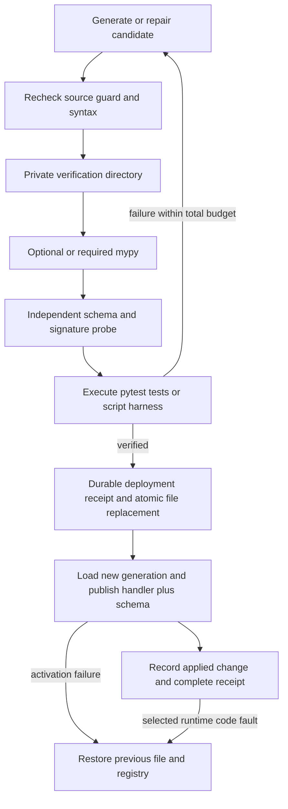

# O.R.I.O.N. systems audit and verified enhancement patches

26 September 2026. Target: Windows desktop, Ryzen 5 3600, RTX 3060 Ti with 8 GiB VRAM.

## Scope and evidential standard

This audit works from the existing, extensively modified checkout. It preserves earlier uncommitted work. Production ORION is a **PyQt6/qasync application with an aiohttp remote gateway**. The FastAPI material in the neural reference documentation is not its production server. Replacing that server or adding FastAPI would introduce an unnecessary migration.

The review combines a complete Python syntax/inventory scan, targeted static searches, manual inspection of the critical execution paths, reproductions and regression tests. The final inventory covers **803 Python files and 253,500 lines** across the package, entry points, launcher, shipped custom tools, development tools and tests, with no syntax errors. It excludes generated distributions, environments, caches and reference examples. This is **not a claim that every line has received manual review**, or that all possible vulnerabilities have been eliminated.

The requested zero-breakage mandate is treated as a regression acceptance criterion. Finite tests cannot mathematically prove the absence of all defects, establish arbitrary generated code's intent, or make a subprocess a security boundary. Where bounded behaviour can be established directly, the invariants are stated below. Hardware throughput, external providers and a running container engine were not benchmarked.

Evidence and reviewable patches are in `reports/architecture_security_2026_09_26/`. The `before/` directory contains the pre-edit versions of files touched by this audit; numbered patches contain **only this audit's changes**, rather than the much larger existing Git diff. The installed `ORION.exe` has not been rebuilt or replaced.

## Phase 1 — Concurrency, security and resource ownership

| Finding | Mechanism and consequence | Resolution |
|---|---|---|
| High: shared Forge staging | Simultaneous attempts wrote the same probe, module aliases and output filenames. One candidate could be checked against another candidate's code or tests. Old files could also satisfy missing imports. | Each attempt owns a temporary directory and a worker copy of the harness. Files are removed after its worker has finished. |
| High: repair bypassed the source guard | Only the first candidate was inspected. A later repair could introduce a forbidden core import and reach execution. | Both artefacts are guarded before **every** verification attempt. |
| High: tests could pass without running | Executing a file containing `def test_failure(): assert False` as a script returns zero without calling the function. | Pytest-style harnesses run through pytest; script-style harnesses remain supported. Both sources are parsed before import. |
| High: MCP command-registration bypass | The model-facing `add` and `enable` actions could install and launch an arbitrary command, outside the normal OS-action gates. | Executable registration, enablement and explicit restart require a local human-issued, single-use token. The prompt shows the executable and arguments; the token binds the payload. Trusted Python host APIs and automatic reconnection remain available. |
| High: unrelated credentials inherited by MCP | Every MCP child received the parent's complete environment, including other providers' tokens. | Credential-like environment variables are withheld unless explicitly configured for that server or named in `inherit_env`. Ordinary execution settings are retained. |
| Medium: activation was not transactional | The installed source was overwritten before loading succeeded; handler and schema were then changed by separate worker awaits. | Atomic source replacement, durable deployment receipt, rollback on failed activation, and publication of handler plus schema without an intervening await on the dispatcher loop. |
| Medium: stale bytecode on rapid replacement | A same-size rewrite within the timestamp cache interval could load the previous `.pyc`. | The loader compiles the actual source bytes. Failed imports restore the previous `sys.modules` entry for all exception types. |
| Medium: cancellation left owned work running | Cancelling an await on `to_thread` does not stop the worker or its subprocess. Cancelling an MCP handshake could leave its child alive. | Verification cancellation signals the runner and waits for cleanup before removing staging. MCP handshake cancellation closes its process and drains its stderr task. |
| Medium: ineffective repairs could loop indefinitely | Mechanical repairs did not consume the code-attempt allowance. A repeatedly “complete” repair could prevent termination. | A separate total verification counter bounds all attempts, including free repairs. |
| Medium: error type lost during redaction | `str.replace` on an `MCPReply` returns an ordinary string, discarding the error-kind metadata. | Redaction preserves the reply's type and failure kind. |
| Medium: unbounded session retention | Finished Forge sessions retain generated source, tests and diagnostics. | Retain the most recent 100 finished sessions, plus active sessions; release completed per-name locks. |
| Medium: file I/O on the qasync thread | Research output, repair-source reads and quarantine reads could wait on OneDrive or antivirus locks while blocking voice and painting. | Move those operations into workers. Compile repair drafts in memory instead of writing shared temporary Python files. |
| Medium: video OCR temporary-name collision | Two calls using the same JPEG bytes object shared `id(jpeg)` and consequently the same filename and cleanup. | A worker owns a unique temporary directory through write, OCR and cleanup. |

The static scan also found a Windows OCR `DataWriter.write_bytes` call. Inspection established that it belongs to the WinRT stream operation inside an OCR worker, not an on-loop filesystem write. It was deliberately retained; moving a thread-affine WinRT object merely to silence a textual search would be an unsound patch.

### Existing safeguards retained

Provider routing already has transient exponential backoff with jitter, quota cooldowns, circuit states and a half-open probe guard. **Second-pass correction:** pooled-session and endpoint-gate helpers exist in `provider_transport.py`, but the live router's per-call session methods do not use them. Their presence must not be counted as deployed resource control. The [second audit](ORION_SYSTEMS_SECURITY_AUDIT_PASS2_2026-09-26.md) connects the shared streaming decoder and documents this integration gap. Agent execution already classifies concurrent reads separately from ordered mutations; those safeguards remain in place.

The existing resource governor uses hysteresis; admission and GPU leases coordinate optional work. The semantic encoder already limits ONNX worker threads. This audit adds no model, CUDA context, Redis daemon or resident indexing service. It makes no claim that these source-level protections prove an 8 GiB peak VRAM budget during an actual voice/vision/Ollama session.

## Phase 2 — Forge verification and deployment



The retry loop is iterative rather than recursive: equivalent bounded repair semantics without accumulating stack frames. If the configured code-attempt budget is `A`, total verification executions are bounded by `A + 4 + 5`. The counter increases on every execution, including dependency and mechanical repairs. Failed declared dependency resolution now prevents activation instead of reporting a successful installation.

Verification supports two profiles:

| Setting | Behaviour |
|---|---|
| `ORION_FORGE_SANDBOX=process` | Existing source-installation compatibility profile: private staging, time/RSS/output checks, credential filtering and owned-process cleanup. **Not an OS sandbox.** |
| `ORION_FORGE_SANDBOX=container` | Run an explicitly built Linux verifier image with no network, no GPU, a read-only filesystem and staging mount, dropped capabilities, no new privileges, one CPU, 512 MiB RAM/swap limit and 64 processes. No implicit image pull or fallback to host execution. |
| `ORION_FORGE_TYPECHECK=auto` | Run mypy when installed; otherwise report `typecheck=unavailable`. This is the compatibility default. |
| `ORION_FORGE_TYPECHECK=required` | A missing or failing type checker rejects the candidate. |
| `ORION_FORGE_TYPECHECK=off` | Explicitly disable type checking and record that fact. |

Sources are limited to 1 MiB each. Output is polled against a 4 MiB combined threshold and reads are capped; the polling limit can be exceeded between samples. The local RSS sampler is a best-effort backstop, not kernel enforcement. Mypy uses a generated configuration with no project plugins, checks untyped function bodies, and skips following dependency imports; it does not certify the dependency graph.

To prepare the optional verifier, from the repository root:

```powershell
docker build -f deploy/forge-verifier.Dockerfile -t orion-forge-verifier:local .
$env:ORION_FORGE_SANDBOX = 'container'
$env:ORION_FORGE_TYPECHECK = 'required'
$env:ORION_FORGE_CONTAINER_IMAGE = 'orion-forge-verifier:local'
```

Review and build the image explicitly. Its Python base tag is mutable; pin the reviewed image digest for reproducible deployment. Add approved tool dependencies to that image at build time. A frozen ORION executable is not a Python interpreter: process verification now refuses to relaunch `ORION.exe` as though it were Python. Use the container profile or run Forge from a Python source environment.

Docker's resource and privilege options provide the basis for this profile; they do not make arbitrary native code infallibly safe. [Docker run documentation](https://docs.docker.com/reference/cli/docker/container/run), [Docker security model](https://docs.docker.com/engine/security/). Mypy's import-following behaviour also limits what a successful check establishes. [Mypy documentation](https://mypy.readthedocs.io/en/stable/running_mypy.html).

### Hot replacement and rollback boundaries

Publication swaps a custom tool's callable and schema on the dispatcher loop. Existing calls retain their previous callable; a regression test holds an old asynchronous call open while publishing the next generation, then confirms that both complete with their respective behaviour. The implementation avoids `importlib.reload` of shared core modules.

Activation failures restore the previous source bytes, module entry, tool handler and schema. A runtime `TypeError`, `AttributeError`, `NameError` or `SyntaxError` in a newly deployed tool triggers rollback, provided the generation is still current and the file has not subsequently been manually edited. The failed request is reported; it is not silently replayed, which could duplicate an external action.

Write-ahead receipts under `.forge_transactions/` allow startup to recover an interrupted deployment. A conflicting manual edit is preserved and held out of automatic reloading. Recovery verifies the backup hash and confines the filename to the custom-tools directory.

These mechanisms restore **code and routing**, not a tool's external side effects. In-process imports and handlers remain trusted-code execution. Safe execution of hostile generated tools requires a persistent out-of-process runtime with an explicit capability broker, not merely sandboxed tests. Hot replacement of arbitrary core state or FastAPI routers is consequently not claimed or introduced.

## Phase 3 — SQLite history and semantic retrieval

`EvolutionStore` records UTC timestamp, module, source, before/after SHA-256 hashes, unified line diff, reasoning, verification evidence, status and optional module version. Status distinguishes verification, failure, application, rollback and unverified observed edits.

Version updates and their event are committed in one `BEGIN IMMEDIATE` transaction. The store uses ORION's shared SQLite pragmas, with `synchronous=FULL` for deployment evidence. Operations open and close their own connections; workers keep waits off the event loop. Contending writers are tested against the same database, including initialisation by separate store instances.

Versions are per module and start at `0.0.0`; explicit `major`, `minor` and `patch` changes have their usual numeric semantics. Failed candidates consume no version. Automated updates and observed edits currently default to patch increments. **These numbers are a local history convention, not proof of API compatibility or replacements for ORION's public release version.** A reviewer must supply the appropriate compatibility impact for a breaking change.

The existing memory matrix receives concise evidence summaries in the `evolution` category. Its existing FTS/semantic retrieval is reused; raw source and diffs remain in SQLite. A durable indexing flag leaves failed memory writes pending, and stable keys make retries idempotent in the RAG index. Local bounded lexical retrieval remains available when the semantic model or memory service is unavailable. Relevant history is fed into subsequent Forge generation alongside the existing lesson store.

Boot-time source awareness observes both `orion_core` and custom tools. First scans establish baselines. Subsequent scans record modifications, additions and removals as **unverified**, without inventing an author's reasoning. Unreadable files are not treated as deletions. History failures are reported without stopping the legacy startup summary.

Automatic observation records differences **between scans**; it cannot reconstruct every intermediate manual save or recover historical reasoning that was never supplied. Call `record(..., source='manual', reasoning=...)` from an editing workflow when individual edits and their intent must be captured. The new database does not backfill a fictitious history from the dirty Git checkout.

## Phase 4 — Agent coordination and CPU cost

Identical instrument reads in one agent batch are now deduplicated by canonical JSON arguments before spending the tool budget. Later batches read fresh state. This removes repeated work without turning live telemetry into a stale cross-turn cache. Existing parallelism limits and the sequential kill switch remain in force.

For the current single-process architecture, retain loop-owned transient state, immutable per-request snapshots, short database transactions and bounded admission. Durable updates should use transactional version checks when multiple workers can mutate the same record. Redis would add a service, failure mode and memory footprint without evidence of a bottleneck requiring it. Cross-process swarm deployment should be a separate migration, with explicit ownership and compare-and-swap semantics, rather than sharing mutable Python objects across arbitrary threads.

## Phase 5 — Free MCP integrations and input policy

The host already provides configured integration code for filesystem, Git, Fetch, browser automation and other servers, plus lazy start, cached catalogues, idle parking and discovery through `find_tool`/`use_tool`. These routes are retained. The Live session need not carry every MCP schema: discovery retrieves the relevant declaration before invocation. The text route already ranks its menu per request.

| Integration | Status and intended use |
|---|---|
| Local filesystem | Existing reference-server integration, now with host-side validation of its path fields against configured roots. Scope roots narrowly. |
| Local Git | Existing `mcp-server-git` integration, now constraining repository/file paths and rejecting option-like revision arguments. Mutating Git operations retain confirmation. |
| Fetch | Existing open-source web extraction integration. Website content remains untrusted; a generic external fetch server is not a host network-security boundary. |
| ORION telemetry | New small stdio server using the existing `psutil` dependency. Read CPU/RAM or bounded process-memory summaries; no account, model, API fee or network listener. Disabled until selected. |

Filesystem, Git and Fetch are maintained as **reference implementations**, whose upstream documentation explicitly asks deployers to assess production security. They should not be described as inherently safe just because they are open source. Review and pin the chosen versions before deployment. [Reference servers](https://github.com/modelcontextprotocol/servers), [filesystem controls](https://github.com/modelcontextprotocol/servers/tree/main/src/filesystem), [Git integration](https://github.com/modelcontextprotocol/servers/tree/main/src/git), [Fetch integration](https://github.com/modelcontextprotocol/servers/tree/main/src/fetch).

The telemetry entry is added disabled to the template/migration. Source installations use the current Python interpreter. Frozen distributions include the server source but need an external Python interpreter with `psutil`. Enable through the existing MCP configuration flow when ready; no server was enabled during this audit.

Request validation rejects non-object/non-finite/oversized JSON and protects the known filesystem/Git path fields. Windows traversal components, device names, UNC/device paths, drive-relative paths, alternate data streams and misleading trailing dots/spaces are rejected. Canonical paths must remain beneath allowed roots; a sibling sharing a textual prefix does not qualify. Resolved symlinks cannot escape the configured roots.

This is defence in depth for **trusted server implementations**. A separate process can race a filesystem check or ignore the supplied arguments. The client does not sandbox arbitrary MCP servers, prevent all fetch-server SSRF, or restrict every possible field in future server schemas. External server annotations are metadata, not authority. [MCP annotation guidance](https://blog.modelcontextprotocol.io/posts/2026-03-16-tool-annotations/).

## Phase 6 — Dependency impact, counter-review and verification

### Dependency impact

| Change | Downstream effect |
|---|---|
| New history store | Standard-library SQLite only; lazy construction. Hooks into desktop Forge, source awareness and existing memory. No second embedding model. |
| Mypy verification | Optional verifier dependency. Missing mypy is explicitly recorded; required mode fails closed. The isolated audit environment does not alter ORION's runtime environment. |
| Pytest execution | Needed only for pytest-style generated harnesses. Existing script harnesses remain supported. Plugin autoload and ancestor conftests are disabled in the verifier. |
| Container profile | Optional Docker Desktop/Linux-container dependency. No daemon is started, image built, package installed into ORION, or profile selected automatically. |
| Telemetry MCP | Reuses `psutil`; no new runtime package. Bundled source is included by the build script. |
| MCP environment/policy | Servers needing an inherited credential must declare it explicitly. Existing catalogue fingerprints change once and may require rediscovery. Executable configuration gains local confirmation. |

### Counter-review

* **“A private folder is a secure sandbox.”** Rejected: it isolates artefacts, not host privileges. The process profile is labelled accordingly; the container profile has no host fallback.
* **“A zero exit code proves tests passed.”** Rejected with a failing pytest function that the previous harness never executed.
* **“Putting registry writes on workers improves concurrency.”** Rejected: separate awaits expose mixed handler/schema generations. Publish these small mutations together on their owning loop.
* **“Cancelling an await kills its thread.”** Rejected: child cleanup is explicitly signalled and awaited; temporary OCR files are owned by the worker that uses them.
* **“Rollback may restore the entire old dispatcher snapshot.”** Rejected: a different tool may have been deployed concurrently. Forge rollback restores only the affected tool.
* **“Passing tests prove semantic compatibility.”** Rejected: generated tests and syntax checks are evidence with limited coverage. Independent contract checks, version-impact review and external integration validation remain necessary.

### Validation record

* Baseline: **7,138 passed, 1 skipped**, before production edits.
* Reproduction: **8 new Forge tests failed** against the original implementation. They exercised the repair guard, file preservation, registry publication, import restoration, attempt isolation, pytest execution and syntax gate.
* Focused checks: Forge, database contention/RAG, live telemetry stdio, confirmation tokens, crash recovery and event-loop I/O were exercised repeatedly as their patches were added. A full run caught the missing shared SQLite-policy call; that defect was corrected and its regression check passed.
* Critical lint checks cover the production package and tests. Mypy passes on the five new infrastructure modules with imports followed only within the stated checking scope.
* Full `tests/` run after production changes: **7,199 passed, 2 skipped**, in 295.89 seconds; `complete.log` and `complete.xml`. The two skips require Windows symlink privileges.
* Additional reference examples: **25 passed, 2 skipped, 7 subtests passed**; `reference.log` and `reference.xml`. These are separate from the production test run.
* Final publication-tool and synthetic-fixture adjustments: **36 passed**; `publication.log` and `publication.xml`. Two additional denied-path cases preserve the narrow source allowlist. Four existing synthetic credential strings are constructed at runtime without weakening the scanner or changing the tested values.
* After moving tests into their matching patch groups: **30 passed, 1 skipped**; `packaging.log` and `packaging.xml`. No production behaviour changed after the full test run.
* Publication audit: **passed**, scanning 964 eligible source files; no archive was created or published. Capability comparison found no missing declarations or duplicates. The final AST inventory records one direct async candidate, the reviewed worker-owned OCR stream operation.
* Patch transport: all eight patches passed reverse checks against this checkout, then forward checks and application against an isolated copy of the saved baseline. All **32 resulting file hashes** matched the edited source. Replay uses a per-command `core.autocrlf=false` setting to preserve exact bytes on Windows; it does not change Git configuration.

The Docker CLI is installed, but the daemon was unavailable. Container command construction and refusal to fall back are tested; a real container build, confinement exercise and image smoke test remain unverified. The Windows symlink-creation test may skip when the current account lacks the required privilege. Paid/live provider calls, destructive tools, the GUI's real rendering, hardware VRAM stress, external MCP package downloads and a rebuilt executable are outside the executed validation.

## Applying the audit as small reviewable patches

The eight numbered patch files are generated against the saved **pre-audit working files**, not Git HEAD. They are already applied in this checkout. Do not apply them a second time. On a matching pre-audit copy, use `git apply --check` before each patch and run its listed focused tests. The [patch guide](../reports/architecture_security_2026_09_26/patches/README.md) and machine-readable manifest identify files, hashes and dependencies so prior uncommitted work remains distinguishable from this audit. Related implementation and tests travel together; Forge publication, history wiring and the I/O checks have explicit dependencies rather than being falsely described as order-independent.

The residual trust boundaries above are material deployment limits. In particular, do not describe compatibility-mode verification or an in-process Python plugin as hostile-code isolation. Stronger isolation of the live tool runtime is the next architectural migration if malicious generated code is in scope.
